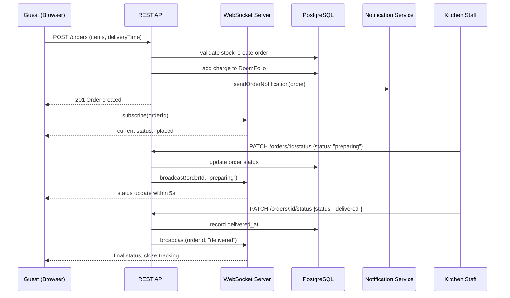
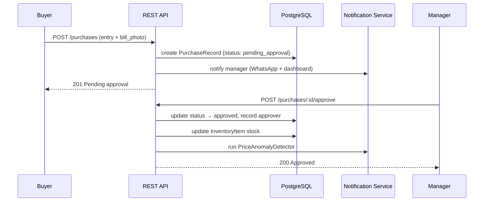
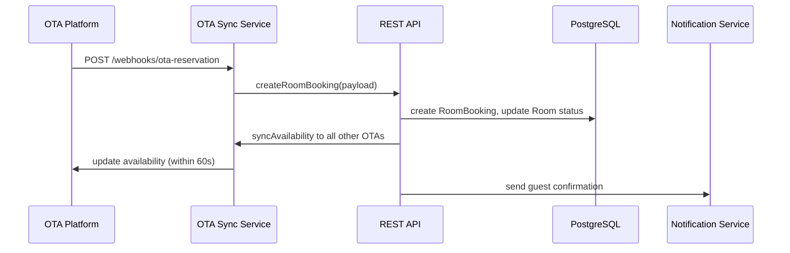
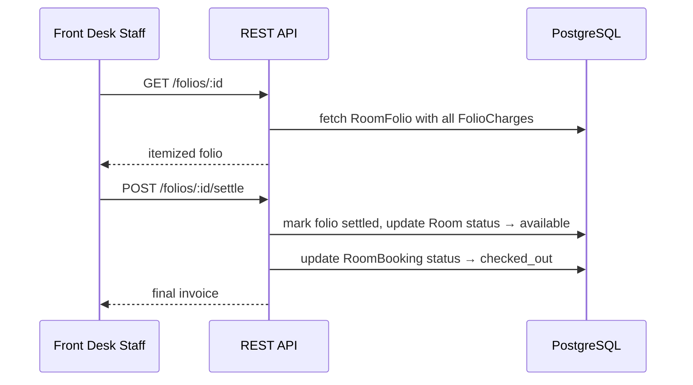

# Design Document: Hotel Food Service System

## Overview

The Hotel Food Service System is a comprehensive hotel operations platform for a single hotel or resort. The platform is split into two distinct frontends:

**Frontend 1 — Guest & POS Website**: The guest-facing web app (QR-accessible, mobile-first) for room booking, food ordering, and service requests. Also includes a POS (Point of Sale) interface for staff at restaurant, spa, and activity desks to view and manage orders in real time, update statuses, and charge items to the guest's room folio.

**Frontend 2 — Staff Dashboard**: An internal operations dashboard for hotel staff and management. Covers all bookings overview, orders and POS activity, room and housekeeping status, inventory management, and management reports.

Staff benefit from role-based tools for order management, inventory control, procurement with bill verification and approval workflows, and task/attendance tracking. The hotel owner gets a full admin dashboard with revenue analytics, room status, staff activity logs, expense analytics, and automated price anomaly alerts. The platform also includes GST and tax compliance, a double-entry accounting system, guest check-in KYC with legal form generation, a real-time Kitchen Display System (KDS), and multi-property support for owners managing multiple locations.

The architecture follows a modular monolith with a TypeScript/Node.js/Express backend, two React frontends, and PostgreSQL database. Real-time features are handled via WebSockets. External integrations cover OTA platforms (Booking.com, Expedia, Airbnb), WhatsApp Business API, and email.

## Architecture

```mermaid
graph TB
    subgraph "Frontend 1 — Guest & POS Website"
        GP[Guest Portal\nQR-accessible, mobile-first\nRoom booking, food ordering, services]
        POS[POS Interface\nRestaurant / Spa / Activity desk\nReal-time order management, charge to room]
    end

    subgraph "Frontend 2 — Staff Dashboard"
        SD_BOOK[Bookings Overview]
        SD_ORDERS[Orders & POS Activity]
        SD_ROOMS[Room & Housekeeping Status]
        SD_INV[Inventory Management]
        SD_REPORTS[Management Reports]
    end

    subgraph "Application Layer"
        API[REST API Server\nExpress + TypeScript]
        WS[WebSocket Server\nlive order tracking + KDS]
        AUTH[Auth Service\nJWT + RBAC]
        NOTIF[Notification Service\nWhatsApp + Email]
        OTA[OTA Sync Service\nchannel manager]
        CRON[Meal Plan Scheduler\ncron jobs]
        QR[QR Code Generator]
        ANOMALY[Price Anomaly Detector]
        ANALYTICS[Expense Analytics Engine]
        GST[GST Service]
        ACCT[Accounting Service]
        KYC[KYC Service]
        KDS[KDS Service]
        MPROP[Multi-Property Service]
    end

    subgraph "Data Layer"
        DB[(PostgreSQL)]
        FS[File Storage\nbill photos, food photos, branding]
    end

    subgraph "External Services"
        WA[WhatsApp Business API]
        EMAIL[Email / SMTP]
        OTA_EXT[OTA Platforms\nBooking.com, Expedia, Airbnb]
    end

    GP --> API
    GP --> WS
    POS --> API
    POS --> WS
    SD_BOOK --> API
    SD_ORDERS --> API
    SD_ORDERS --> WS
    SD_ROOMS --> API
    SD_INV --> API
    SD_REPORTS --> API

    API --> AUTH
    API --> NOTIF
    API --> OTA
    API --> QR
    API --> ANOMALY
    API --> ANALYTICS
    API --> DB
    API --> FS
    WS --> DB
    CRON --> API
    NOTIF --> WA
    NOTIF --> EMAIL
    OTA --> OTA_EXT
```



## Frontend Architecture

### Frontend 1 — Guest & POS Website

**Purpose**: Public-facing and QR-accessible web app. Serves two audiences on the same frontend:

**Guest Side**:
- Room booking (direct booking engine)
- Food ordering with live order tracking
- Service requests (housekeeping, laundry, room service)
- Amenity booking
- Room folio view
- In-app messaging with reception

**POS Side** (staff at restaurant/spa/activity desk):
- Real-time order queue for their station (restaurant, spa, activity)
- Update order status (preparing → ready → delivered)
- Charge items directly to guest room folio
- View active guest folios for charge-to-room
- Accessible via staff login on the same domain

**Routing**:
- `/` — Landing page
- `/book` — Direct booking engine (public)
- `/guest` — Guest portal (authenticated guest)
- `/pos` — POS interface (authenticated POS staff)
- `/login` — Unified login (guest access + staff login toggle)

---

### Frontend 2 — Staff Dashboard

**Purpose**: Internal operations dashboard for hotel management and back-office staff.

**Sections**:
- **Bookings Overview** — All current, upcoming, and past bookings; check-in/check-out management; OTA sync status
- **Orders & POS Activity** — All food/service orders across all stations; real-time status; folio charge log
- **Room & Housekeeping Status** — Room status grid (available/occupied/cleaning); housekeeping task queue; maintenance requests
- **Inventory Management** — Multi-category inventory (food/housekeeping/maintenance); procurement entries; supplier directory; purchase approval workflow; price anomaly alerts
- **Management Reports** — Revenue metrics; expense analytics; payroll summary; GST reports; staff attendance; top guests

**Routing**:
- `/` — Dashboard home (summary cards)
- `/bookings` — Bookings overview
- `/orders` — Orders & POS activity
- `/rooms` — Room & housekeeping status
- `/inventory` — Inventory management
- `/reports` — Management reports
- `/staff` — Staff management (tasks, attendance, payroll)
- `/settings` — Hotel config, branding, OTA platforms, GST config

**Access**: Staff Dashboard is only accessible to authenticated staff with roles: `admin`, `manager`, `kitchen`, `buyer`, `housekeeping`, `maintenance`.

### Technology Stack

- **Frontend**: React (TypeScript), mobile-first responsive design
- **Backend**: Node.js + Express (TypeScript)
- **Database**: PostgreSQL with proper indexing and audit tables
- **Real-time**: WebSockets (ws or Socket.IO)
- **File Storage**: Cloud object storage (S3-compatible) for photos
- **Authentication**: JWT-based, role-based access control (RBAC)
- **Notifications**: WhatsApp Business API + SMTP
- **Scheduling**: node-cron for meal plan auto-order generation
- **QR Codes**: qrcode npm library

## Components and Interfaces

### Guest Portal

**Purpose**: Mobile-first web app accessible via QR code scan. No app download required.

**Interface**:
```typescript
interface GuestPortal {
  authenticate(phone: string, roomNumber: string): Promise<AuthResult>
  browseMenu(): Promise<FoodItem[]>
  placeOrder(items: OrderItem[], deliveryTime: Date): Promise<Order>
  trackOrder(orderId: string): WebSocketSubscription
  submitServiceRequest(type: ServiceRequestType, notes?: string): Promise<ServiceRequest>
  viewActiveMealPlan(): Promise<MealPlanSubscription | null>
  viewRoomFolio(): Promise<RoomFolio>
}
```

**Responsibilities**:
- Render hotel-branded landing page within 3 seconds on mobile
- Pre-fill room number from QR code URL parameter
- Display live order tracking via WebSocket subscription
- Show active service requests and their statuses

---

### Direct Booking Engine

**Purpose**: Publicly accessible room booking page, no login required.

**Interface**:
```typescript
interface DirectBookingEngine {
  searchAvailableRooms(checkIn: Date, checkOut: Date): Promise<Room[]>
  submitBooking(details: BookingRequest): Promise<RoomBooking>
  getBookingConfirmation(bookingId: string): Promise<RoomBooking>
}
```

**Responsibilities**:
- Display room types with photos, capacity, and price
- Check live availability before confirming
- Trigger OTA sync and guest notification on confirmation

---

### Kitchen / Staff Portal

**Purpose**: Order queue management and service request handling for kitchen and housekeeping staff.

**Interface**:
```typescript
interface StaffPortal {
  getOrderQueue(): Promise<Order[]>
  claimOrder(orderId: string): Promise<Order>
  updateOrderStatus(orderId: string, status: OrderStatus): Promise<Order>
  getServiceRequests(): Promise<ServiceRequest[]>
  updateServiceRequestStatus(id: string, status: ServiceRequestStatus): Promise<ServiceRequest>
  logKitchenConsumption(entry: KitchenConsumptionEntry): Promise<KitchenConsumption>
  updateTaskStatus(taskId: string, status: TaskStatus): Promise<StaffTask>
  logAttendance(type: 'check_in' | 'check_out'): Promise<AttendanceRecord>
}
```

---

### Buyer Portal

**Purpose**: Procurement recording with bill photo upload, supplier selection, and approval submission.

**Interface**:
```typescript
interface BuyerPortal {
  getIngredientList(): Promise<InventoryItem[]>
  submitProcurementEntry(entry: ProcurementEntry, billPhoto: File): Promise<PurchaseRecord>
  getPurchaseHistory(): Promise<PurchaseRecord[]>
  addSupplier(supplier: SupplierInput): Promise<Supplier>
}
```

---

### Manager Portal

**Purpose**: Task assignment, purchase approval, and staff oversight.

**Interface**:
```typescript
interface ManagerPortal {
  approvePurchase(recordId: string): Promise<PurchaseRecord>
  rejectPurchase(recordId: string, reason: string): Promise<PurchaseRecord>
  createStaffTask(task: StaffTaskInput): Promise<StaffTask>
  viewDailyTasks(): Promise<StaffTask[]>
  viewAttendance(date: Date): Promise<AttendanceRecord[]>
  getPendingApprovals(): Promise<PurchaseRecord[]>
}
```

---

### Admin Dashboard

**Purpose**: Owner-only control panel for full operational visibility.

**Interface**:
```typescript
interface AdminDashboard {
  getRevenueMetrics(period: 'day' | 'week' | 'month'): Promise<RevenueMetrics>
  getRoomStatusOverview(): Promise<RoomStatusSummary[]>
  getStaffActivityLog(): Promise<ActivityLogEntry[]>
  getExpenseAnalytics(month: string): Promise<ExpenseAnalytics>
  getPriceAnomalyAlerts(): Promise<PriceAnomalyAlert[]>
  reviewAnomalyAlert(alertId: string, note?: string): Promise<PriceAnomalyAlert>
  getOTASyncStatus(): Promise<OTAPlatformConfig[]>
  exportReport(type: ReportType, format: 'pdf' | 'csv'): Promise<Blob>
  exportExpenseAnalytics(period: DateRange): Promise<Blob>
}
```

---

### QR Code Generator

**Purpose**: Generate and manage per-room QR codes encoding room-specific URLs.

**Interface**:
```typescript
interface QRCodeGenerator {
  generateForRoom(roomId: string, roomNumber: string): Promise<string> // returns QR image URL
  regenerateForRoom(roomId: string): Promise<string>
  downloadQRCode(roomId: string): Promise<Blob>
}
```

---

### Live Order Tracking (WebSocket)

**Purpose**: Push real-time order status updates to guests without page refresh.

**Interface**:
```typescript
interface LiveOrderTracker {
  subscribe(orderId: string, guestSocket: WebSocket): void
  broadcast(orderId: string, status: OrderStatus, estimatedDelivery: Date): void
  unsubscribe(orderId: string, guestSocket: WebSocket): void
}
```

**Behavior**:
- Status changes broadcast within 5 seconds of staff update
- On WebSocket disconnect, client auto-reconnects with exponential backoff (1s, 2s, 4s, max 30s)
- Reconnected clients receive current status immediately on re-subscribe

---

### Meal Plan Scheduler

**Purpose**: Cron-based service that auto-generates orders for active meal plan subscriptions.

**Interface**:
```typescript
interface MealPlanScheduler {
  scheduleForSubscription(subscription: MealPlanSubscription): void
  cancelSchedule(subscriptionId: string): void
  runDailyGeneration(): Promise<Order[]> // triggered by cron
}
```

**Behavior**:
- Runs at configured meal times (e.g., 07:30 breakfast, 12:30 lunch, 19:00 dinner)
- Skips generation if subscription is cancelled or end_date has passed
- Generated orders are treated identically to manually placed orders

---

### Room Folio / Billing Service

**Purpose**: Accumulate all guest charges and generate consolidated invoices at checkout.

**Interface**:
```typescript
interface FolioService {
  getOrCreateFolio(customerId: string, bookingId: string): Promise<RoomFolio>
  addCharge(folioId: string, charge: FolioChargeInput): Promise<FolioCharge>
  viewFolio(folioId: string): Promise<RoomFolioWithCharges>
  generateInvoice(folioId: string): Promise<Invoice>
  settleFolio(folioId: string): Promise<RoomFolio>
}
```

---

### OTA Channel Manager

**Purpose**: Sync room availability and pricing with external OTA platforms.

**Interface**:
```typescript
interface OTAChannelManager {
  syncAvailability(roomId: string): Promise<void>
  syncPricing(roomId: string, price: number): Promise<void>
  receiveReservation(platform: string, payload: OTAReservationPayload): Promise<RoomBooking>
  retryFailedSync(platformId: string): Promise<void>
  getSyncStatus(): Promise<OTAPlatformConfig[]>
}
```

**Behavior**:
- Syncs within 60 seconds of any booking or price change
- Retries up to 3 times on failure with exponential backoff
- Alerts owner via WhatsApp + email on persistent failure

---

### Supplier Management

**Purpose**: Maintain vendor directory and link all purchases to suppliers.

**Interface**:
```typescript
interface SupplierService {
  addSupplier(input: SupplierInput): Promise<Supplier>
  updateSupplier(id: string, input: Partial<SupplierInput>): Promise<Supplier>
  deactivateSupplier(id: string): Promise<Supplier>
  getSuppliers(category?: string): Promise<Supplier[]>
  getPurchasesBySupplier(supplierId: string): Promise<PurchaseRecord[]>
  getPriceComparisonByItem(itemId: string): Promise<SupplierPriceComparison[]>
}
```

---

### Purchase Approval Workflow

**Purpose**: Gate inventory updates behind manager/admin approval.

**Interface**:
```typescript
interface PurchaseApprovalService {
  submitForApproval(recordId: string): Promise<PurchaseRecord>
  approve(recordId: string, approverId: string): Promise<PurchaseRecord>
  reject(recordId: string, approverId: string, reason: string): Promise<PurchaseRecord>
  getPendingApprovals(): Promise<PurchaseRecord[]>
}
```

---

### Price Anomaly Detector

**Purpose**: Flag procurement entries where price exceeds 150% of 30-day historical average.

**Interface**:
```typescript
interface PriceAnomalyDetector {
  analyze(ingredientId: string, submittedPrice: number): Promise<AnomalyResult>
  createAlert(purchaseRecordId: string, result: AnomalyResult): Promise<PriceAnomalyAlert>
  reviewAlert(alertId: string, reviewerId: string, note?: string): Promise<PriceAnomalyAlert>
}
```

**Behavior**:
- Skips detection if fewer than 3 historical records exist for the ingredient
- Sends owner alert within 60 seconds of flagging

---

### Expense Analytics Engine

**Purpose**: Aggregate procurement, consumption, and supplier data for owner reporting.

**Interface**:
```typescript
interface ExpenseAnalyticsEngine {
  getMonthlyCategoryBreakdown(month: string): Promise<CategoryExpense[]>
  getSupplierPriceComparison(itemId: string, range: DateRange): Promise<SupplierPriceComparison[]>
  getUsageVsCostAnalysis(period: DateRange): Promise<UsageCostAnalysis[]>
  getFlaggedIrregularities(filters: IrregularityFilters): Promise<FlaggedIrregularity[]>
  exportToCSV(period: DateRange): Promise<Blob>
}
```

---

### Notification Service

**Purpose**: Dispatch WhatsApp and email notifications with logging.

**Interface**:
```typescript
interface NotificationService {
  sendWhatsApp(recipient: string, message: string): Promise<NotificationLog>
  sendEmail(recipient: string, subject: string, body: string): Promise<NotificationLog>
  sendOrderNotification(order: Order): Promise<void>
  sendServiceRequestNotification(request: ServiceRequest): Promise<void>
  sendAnomalyAlert(alert: PriceAnomalyAlert): Promise<void>
  sendOTASyncFailureAlert(platform: string, reason: string): Promise<void>
}
```

---

### Guest Feedback Service

**Purpose**: Collect star ratings and comments from guests for orders and service requests; alert managers on low scores.

**Interface**:
```typescript
interface GuestFeedbackService {
  submitRating(customerId: string, targetType: 'order' | 'service_request', targetId: string, stars: number, comment?: string): Promise<GuestRating>
  getRatingsByFoodItem(foodItemId: string): Promise<RatingsSummary>
  getRatingsByStaff(staffId: string): Promise<RatingsSummary>
  getRatingsByServiceType(type: string): Promise<RatingsSummary>
}
```

**Responsibilities**:
- Accept ratings only for delivered orders or completed service requests belonging to the authenticated guest
- Ratings of 2 stars or below trigger a manager alert via WhatsApp within 60 seconds
- Aggregate ratings into RatingsSummary (average, count, distribution) per food item, staff member, and service type

---

### Payment Gateway Service

**Purpose**: Handle online payment collection, verification, and refunds via an external payment gateway.

**Interface**:
```typescript
interface PaymentGatewayService {
  initiatePayment(folioId: string, amount: number, method: 'card' | 'upi'): Promise<PaymentTransaction>
  verifyPayment(transactionId: string): Promise<PaymentTransaction>
  initiateRefund(transactionId: string, amount: number): Promise<PaymentTransaction>
  getTransactionsByFolio(folioId: string): Promise<PaymentTransaction[]>
}
```

**Responsibilities**:
- Integrates with Razorpay or Stripe
- Payment status lifecycle: `pending` → `paid` | `failed`; refunds produce a separate `refunded` transaction
- Folio status is only updated to `settled` after the gateway confirms `paid` status
- All gateway responses logged as PaymentTransaction records

---

### Housekeeping Workflow Service

**Purpose**: Automatically trigger and track room cleaning tasks on guest checkout.

**Interface**:
```typescript
interface HousekeepingService {
  triggerCheckoutCleaning(roomId: string, checkoutTime: Date): Promise<StaffTask>
  getCleaningQueue(): Promise<HousekeepingTask[]>
  markRoomCleaned(taskId: string, staffId: string): Promise<Room>
  assignHousekeepingStaff(roomId: string, staffId: string): Promise<StaffTask>
}
```

**Responsibilities**:
- On checkout, auto-creates a StaffTask of type `housekeeping` and transitions Room.status from `occupied` to `cleaning`
- Marking a task cleaned transitions Room.status from `cleaning` to `available`
- Cleaning queue is sorted by checkout time (earliest first)

---

### Maintenance Request Service

**Purpose**: Track and resolve maintenance issues reported by guests or staff.

**Interface**:
```typescript
interface MaintenanceService {
  submitRequest(input: MaintenanceRequestInput): Promise<MaintenanceRequest>
  assignToStaff(requestId: string, staffId: string): Promise<MaintenanceRequest>
  updateStatus(requestId: string, status: MaintenanceStatus): Promise<MaintenanceRequest>
  getOpenRequests(): Promise<MaintenanceRequest[]>
}
```

**Responsibilities**:
- Accepts requests from both guests (via guest portal) and staff
- Status transitions: `submitted` → `acknowledged` → `in_progress` → `resolved`
- Guest notification sent only upon reaching `resolved`
- Open requests visible to managers and admins with priority sorting

---

### Payroll Service

**Purpose**: Calculate, approve, and archive monthly payroll records derived from attendance data.

**Interface**:
```typescript
interface PayrollService {
  calculateMonthlyPayroll(month: string): Promise<PayrollRecord[]>
  approvePayroll(month: string, approverId: string): Promise<PayrollRecord[]>
  generatePayslip(staffId: string, month: string): Promise<Payslip>
  getPayrollHistory(staffId: string): Promise<PayrollRecord[]>
}
```

**Responsibilities**:
- Calculates gross pay from AttendanceRecord data and StaffSalaryConfig
- Net pay = gross pay − deductions
- Payroll records are immutable after finalization (`status: 'finalized'`)
- Stores payroll for a minimum of 24 months

---

### Multi-Language Service

**Purpose**: Serve UI translations and persist per-guest language preferences.

**Interface**:
```typescript
interface I18nService {
  getAvailableLanguages(): Promise<Language[]>
  getTranslations(lang: string): Promise<TranslationMap>
  updateTranslation(lang: string, key: string, value: string): Promise<void>
  setGuestLanguagePreference(customerId: string, lang: string): Promise<void>
}
```

**Responsibilities**:
- Translation maps loaded at app startup and cached; cache invalidated on `updateTranslation`
- Guest language preference persisted on Customer record and applied on every subsequent request
- Admin can add new languages and update translation strings at runtime

---

### Guest Messaging Service

**Purpose**: Provide an in-app messaging channel between guests and hotel staff.

**Interface**:
```typescript
interface GuestMessagingService {
  sendMessage(customerId: string, content: string): Promise<GuestMessage>
  replyToMessage(messageId: string, staffId: string, content: string): Promise<GuestMessage>
  getInbox(): Promise<GuestMessage[]>
  getConversation(customerId: string): Promise<GuestMessage[]>
  markAsRead(messageId: string): Promise<void>
}
```

**Responsibilities**:
- Messages delivered in real-time via WebSocket where available; fallback to polling
- Staff inbox shows all unread guest messages sorted by recency
- `markAsRead` updates `is_read` flag and broadcasts read receipt to guest

---

### Amenity Booking Service

**Purpose**: Manage hotel amenity inventory (spa, gym, pool, etc.) with slot-based booking and optional folio charging.

**Interface**:
```typescript
interface AmenityService {
  getAmenities(): Promise<Amenity[]>
  getAvailableSlots(amenityId: string, date: Date): Promise<AmenitySlot[]>
  bookSlot(customerId: string, slotId: string): Promise<AmenityBooking>
  getDailyBookings(date: Date): Promise<AmenityBooking[]>
  createAmenity(input: AmenityInput): Promise<Amenity>
  updateAmenity(id: string, input: Partial<AmenityInput>): Promise<Amenity>
}
```

**Responsibilities**:
- Slot capacity enforced at booking time; attempts beyond capacity are rejected
- If the amenity has a `price_per_slot`, booking auto-charges to the guest's RoomFolio via FolioCharge
- Cancellation reverses the folio charge if payment has not yet been settled

---

### Minibar Tracking Service

**Purpose**: Log in-room minibar consumption by staff and auto-charge to the guest folio.

**Interface**:
```typescript
interface MinibarService {
  logConsumption(roomId: string, itemId: string, quantity: number, staffId: string): Promise<MinibarCharge>
  getMinibarItems(): Promise<MinibarItem[]>
  updateMinibarItem(id: string, input: Partial<MinibarItemInput>): Promise<MinibarItem>
}
```

**Responsibilities**:
- Each consumption log immediately creates a FolioCharge (quantity × unit_price) on the active room folio
- Folio total is updated atomically with the charge creation
- Minibar item catalogue managed by admin/manager

---

### Loyalty Service

**Purpose**: Track repeat guests, link bookings to profiles, and manage loyalty tier assignments.

**Interface**:
```typescript
interface LoyaltyService {
  linkBookingToProfile(phone: string, bookingId: string): Promise<Customer | null>
  getVisitHistory(customerId: string): Promise<VisitHistory>
  assignLoyaltyTier(customerId: string, tier: LoyaltyTier): Promise<Customer>
  getTopGuests(limit: number, dateRange?: DateRange): Promise<TopGuest[]>
}
```

**Responsibilities**:
- Matches bookings to existing Customer profiles by phone number
- Visit history aggregates all past bookings, total spend, and stay count
- Loyalty tier (`bronze`, `silver`, `gold`, `platinum`) stored on Customer record
- Top-guest report sortable by visit count or total spend within a date range

---

### Rate Plan Service

**Purpose**: Define date-range and day-of-week pricing rules that override base room prices.

**Interface**:
```typescript
interface RatePlanService {
  createRatePlan(input: RatePlanInput): Promise<RatePlan>
  getActivePlanForDate(roomType: string, date: Date): Promise<RatePlan | null>
  getPricingCalendar(roomType: string, month: string): Promise<PricingCalendarEntry[]>
  updateRatePlan(id: string, input: Partial<RatePlanInput>): Promise<RatePlan>
}
```

**Responsibilities**:
- Rate plans are matched by room type, date range, and day of week
- If multiple plans match, the most specific (narrowest date range) takes precedence
- Falls back to `Room.price_per_night` if no active rate plan matches the requested date
- Pricing calendar exposes the effective price for every day in a given month

---

### Lost and Found Service

**Purpose**: Log, match, and resolve lost and found items reported by guests and staff.

**Interface**:
```typescript
interface LostFoundService {
  logFoundItem(input: FoundItemInput): Promise<LostFoundItem>
  reportLostItem(customerId: string, input: LostItemReport): Promise<LostFoundItem>
  matchItems(foundId: string, lostId: string, staffId: string): Promise<LostFoundItem>
  archiveCase(itemId: string, notes: string, staffId: string): Promise<LostFoundItem>
  getOpenItems(status?: 'found' | 'lost' | 'claimed'): Promise<LostFoundItem[]>
}
```

**Responsibilities**:
- Staff log found items with description, location, and optional photo
- Guests report lost items via the guest portal
- Manual matching by staff links a found item to a lost report and transitions both to `matched`
- Archiving closes the case with resolution notes; archived items are excluded from open item queries

## Data Models

### Room
```typescript
interface Room {
  id: string                  // UUID
  room_number: string
  room_type: string           // e.g. "Standard", "Deluxe", "Suite"
  capacity: number
  price_per_night: number
  status: 'available' | 'occupied' | 'cleaning'
  floor: number
  photo_url?: string
  description?: string
  created_at: Date
  updated_at: Date
}
```

### Customer
```typescript
interface Customer {
  id: string                  // UUID
  phone_number: string        // unique
  room_number: string
  name: string
  check_in_date: Date
  check_out_date?: Date
  created_at: Date
  updated_at: Date
}
```

### RoomBooking
```typescript
interface RoomBooking {
  id: string                  // UUID
  guest_name: string
  phone: string
  room_id: string             // FK → Room
  check_in: Date
  check_out: Date
  source: 'direct' | 'ota'
  ota_platform?: string       // e.g. "booking.com"
  ota_reservation_id?: string
  status: 'confirmed' | 'cancelled' | 'checked_in' | 'checked_out'
  total_price: number
  created_at: Date
  updated_at: Date
}
```

### RoomFolio
```typescript
interface RoomFolio {
  id: string                  // UUID
  customer_id: string         // FK → Customer
  room_id: string             // FK → Room
  booking_id: string          // FK → RoomBooking
  total: number               // computed from charges
  status: 'open' | 'settled'
  created_at: Date
  settled_at?: Date
}
```

### FolioCharge
```typescript
interface FolioCharge {
  id: string                  // UUID
  folio_id: string            // FK → RoomFolio
  type: 'food' | 'service' | 'room' | 'misc'
  reference_id?: string       // FK → Order or ServiceRequest
  description: string
  amount: number
  timestamp: Date
}
```

### FoodItem
```typescript
interface FoodItem {
  id: string                  // UUID
  name: string
  description: string
  photo_url?: string
  price: number
  current_stock: number
  minimum_threshold: number
  is_available: boolean
  created_at: Date
  updated_at: Date
}
```

### Order
```typescript
interface Order {
  id: string                  // UUID
  customer_id: string         // FK → Customer
  status: 'placed' | 'preparing' | 'out_for_delivery' | 'delivered' | 'cancelled'
  delivery_time: Date
  total_amount: number
  notes?: string
  claimed_by?: string         // FK → StaffMember
  claimed_at?: Date
  delivered_at?: Date
  estimated_delivery?: Date
  source: 'manual' | 'meal_plan'
  meal_plan_subscription_id?: string
  created_at: Date
  updated_at: Date
}
```

### OrderItem
```typescript
interface OrderItem {
  id: string                  // UUID
  order_id: string            // FK → Order
  food_item_id: string        // FK → FoodItem
  quantity: number
  unit_price: number
  subtotal: number
}
```

### ServiceRequest
```typescript
interface ServiceRequest {
  id: string                  // UUID
  customer_id: string         // FK → Customer
  room_number: string
  type: 'housekeeping' | 'laundry' | 'room_service'
  status: 'submitted' | 'acknowledged' | 'in_progress' | 'completed'
  notes?: string
  charge?: number             // optional associated charge
  created_at: Date
  updated_at: Date
}
```

### MealPlan
```typescript
interface MealPlan {
  id: string                  // UUID
  name: string
  dietary_preference: 'vegetarian' | 'non_vegetarian' | 'vegan'
  meals: {
    breakfast?: string[]      // food item IDs
    lunch?: string[]
    dinner?: string[]
  }
  created_by: string          // FK → StaffMember
  created_at: Date
}
```

### MealPlanSubscription
```typescript
interface MealPlanSubscription {
  id: string                  // UUID
  customer_id: string         // FK → Customer
  meal_plan_id: string        // FK → MealPlan
  start_date: Date
  end_date: Date
  status: 'active' | 'cancelled'
  cancelled_at?: Date
}
```

### InventoryItem
```typescript
interface InventoryItem {
  id: string                  // UUID
  name: string
  unit: string                // kg, liters, pieces, etc.
  category: 'food' | 'housekeeping' | 'maintenance'
  current_stock: number
  minimum_threshold: number
  last_purchase_price?: number
  created_at: Date
  updated_at: Date
}
```

### Supplier
```typescript
interface Supplier {
  id: string                  // UUID
  name: string
  contact_number: string
  category: string            // type of goods supplied
  is_active: boolean
  created_by: string          // FK → StaffMember
  created_at: Date
  updated_at: Date
}
```

### PurchaseRecord
```typescript
interface PurchaseRecord {
  id: string                  // UUID
  ingredient_id: string       // FK → InventoryItem
  supplier_id: string         // FK → Supplier (required)
  quantity: number
  unit_price: number
  total_cost: number
  purchased_by: string        // FK → StaffMember (buyer)
  purchase_date: Date
  bill_photo_url: string      // required
  inventory_category: 'food' | 'housekeeping' | 'maintenance'
  approval_status: 'pending_approval' | 'approved' | 'rejected'
  approved_by?: string        // FK → StaffMember
  approved_at?: Date
  rejection_reason?: string
  notes?: string
}
```

### KitchenConsumption
```typescript
interface KitchenConsumption {
  id: string                  // UUID
  ingredient_id: string       // FK → InventoryItem
  quantity_used: number
  date: Date
  logged_by: string           // FK → StaffMember
  created_at: Date
}
```

### StaffMember
```typescript
interface StaffMember {
  id: string                  // UUID
  username: string            // unique
  password_hash: string
  role: 'admin' | 'manager' | 'kitchen' | 'buyer' | 'housekeeping'
  phone_number?: string
  email?: string
  is_active: boolean
  created_at: Date
  updated_at: Date
}
```

### StaffTask
```typescript
interface StaffTask {
  id: string                  // UUID
  title: string
  description: string
  assigned_to: string         // FK → StaffMember
  assigned_by: string         // FK → StaffMember
  due_time: Date
  status: 'pending' | 'in_progress' | 'completed'
  created_at: Date
  updated_at: Date
}
```

### AttendanceRecord
```typescript
interface AttendanceRecord {
  id: string                  // UUID
  staff_id: string            // FK → StaffMember
  check_in: Date
  check_out?: Date
  date: Date                  // date-only for indexing
}
```

### OTAPlatformConfig
```typescript
interface OTAPlatformConfig {
  id: string                  // UUID
  platform_name: string       // "booking.com", "expedia", "airbnb"
  api_key: string             // encrypted at rest
  is_active: boolean
  last_sync_at?: Date
  last_sync_status?: 'success' | 'failed'
  last_failure_reason?: string
}
```

### PriceAnomalyAlert
```typescript
interface PriceAnomalyAlert {
  id: string                  // UUID
  purchase_record_id: string  // FK → PurchaseRecord
  ingredient_id: string       // FK → InventoryItem
  submitted_price: number
  historical_average: number
  deviation_percent: number
  reviewed_by?: string        // FK → StaffMember
  review_note?: string
  reviewed_at?: Date
  created_at: Date
}
```

### NotificationLog
```typescript
interface NotificationLog {
  id: string                  // UUID
  type: 'whatsapp' | 'email'
  recipient: string
  content: string
  status: 'sent' | 'failed' | 'retrying'
  sent_at?: Date
  error?: string
  created_at: Date
}
```

### HotelConfig
```typescript
interface HotelConfig {
  id: string                  // UUID
  hotel_name: string
  logo_url?: string
  cover_photo_url?: string
  opening_time: string        // "HH:MM"
  closing_time: string        // "HH:MM"
  whatsapp_numbers: string[]
  notification_emails: string[]
  attendance_tracking_enabled: boolean
  updated_at: Date
}
```

### GuestRating
```typescript
interface GuestRating {
  id: string
  customer_id: string         // FK → Customer
  target_type: 'order' | 'service_request'
  target_id: string           // FK → Order or ServiceRequest
  stars: number               // 1–5
  comment?: string
  created_at: Date
}
```

### PaymentTransaction
```typescript
interface PaymentTransaction {
  id: string
  folio_id: string            // FK → RoomFolio
  booking_id?: string         // FK → RoomBooking
  amount: number
  method: 'card' | 'upi' | 'cash'
  status: 'paid' | 'pending' | 'refunded' | 'failed'
  gateway_transaction_id?: string
  initiated_by?: string       // FK → StaffMember (for cash settlements)
  created_at: Date
  updated_at: Date
}
```

### MaintenanceRequest
```typescript
interface MaintenanceRequest {
  id: string
  submitted_by_type: 'guest' | 'staff'
  customer_id?: string        // FK → Customer (if guest)
  submitted_by_staff?: string // FK → StaffMember (if staff)
  location: string            // room number or common area
  category: string            // AC, plumbing, electrical, etc.
  description: string
  status: 'submitted' | 'acknowledged' | 'in_progress' | 'resolved'
  assigned_to?: string        // FK → StaffMember
  priority: 'low' | 'medium' | 'high'
  resolved_at?: Date
  created_at: Date
  updated_at: Date
}
```

### PayrollRecord
```typescript
interface PayrollRecord {
  id: string
  staff_id: string            // FK → StaffMember
  month: string               // "YYYY-MM"
  days_present: number
  days_absent: number
  overtime_hours: number
  gross_pay: number
  deductions: number
  net_pay: number
  status: 'draft' | 'approved' | 'finalized'
  approved_by?: string        // FK → StaffMember
  approved_at?: Date
  created_at: Date
}
```

### GuestMessage
```typescript
interface GuestMessage {
  id: string
  customer_id: string         // FK → Customer
  sender_type: 'guest' | 'staff'
  sender_id: string           // FK → Customer or StaffMember
  content: string
  is_read: boolean
  created_at: Date
}
```

### Amenity
```typescript
interface Amenity {
  id: string
  name: string
  description?: string
  price_per_slot?: number     // null = free
  slot_duration_minutes: number
  capacity_per_slot: number
  is_active: boolean
  created_at: Date
  updated_at: Date
}
```

### AmenitySlot
```typescript
interface AmenitySlot {
  id: string
  amenity_id: string          // FK → Amenity
  date: Date
  start_time: string          // "HH:MM"
  end_time: string            // "HH:MM"
  capacity: number
  booked_count: number
}
```

### AmenityBooking
```typescript
interface AmenityBooking {
  id: string
  customer_id: string         // FK → Customer
  slot_id: string             // FK → AmenitySlot
  folio_charge_id?: string    // FK → FolioCharge (if priced)
  status: 'confirmed' | 'cancelled'
  created_at: Date
}
```

### MinibarItem
```typescript
interface MinibarItem {
  id: string
  name: string
  price: number
  is_active: boolean
  created_at: Date
  updated_at: Date
}
```

### MinibarCharge
```typescript
interface MinibarCharge {
  id: string
  room_id: string             // FK → Room
  customer_id: string         // FK → Customer
  item_id: string             // FK → MinibarItem
  quantity: number
  unit_price: number
  total: number
  logged_by: string           // FK → StaffMember
  folio_charge_id: string     // FK → FolioCharge
  created_at: Date
}
```

### RatePlan
```typescript
interface RatePlan {
  id: string
  name: string
  room_type: string
  price_per_night: number
  start_date: Date
  end_date: Date
  days_of_week: number[]      // 0=Sun, 1=Mon, ..., 6=Sat
  is_active: boolean
  created_by: string          // FK → StaffMember
  created_at: Date
  updated_at: Date
}
```

### LostFoundItem
```typescript
interface LostFoundItem {
  id: string
  type: 'found' | 'lost'
  description: string
  location_found?: string
  date_found?: Date
  date_lost?: Date
  customer_id?: string        // FK → Customer (if reported by guest)
  logged_by?: string          // FK → StaffMember (if found by staff)
  photo_url?: string
  status: 'open' | 'matched' | 'claimed' | 'archived'
  matched_item_id?: string    // FK → LostFoundItem
  resolution_notes?: string
  resolved_by?: string        // FK → StaffMember
  resolved_at?: Date
  created_at: Date
}
```

### StaffSalaryConfig
```typescript
interface StaffSalaryConfig {
  id: string
  staff_id: string            // FK → StaffMember (unique)
  salary_type: 'monthly' | 'daily'
  base_amount: number         // monthly salary or daily rate
  effective_from: Date
  created_by: string          // FK → StaffMember
  created_at: Date
}
```

### GST Service

**Purpose**: Calculate GST on invoices, manage HSN/SAC codes, and generate GSTR-1 and GSTR-3B reports.

**Interface**:
```typescript
interface GSTService {
  calculateGST(amount: number, category: 'room' | 'food' | 'service', isInterState: boolean): GSTBreakdown
  assignHSNSAC(itemId: string, type: 'food_item' | 'service', code: string): Promise<void>
  generateGSTR1(from: Date, to: Date): Promise<GSTReport>
  generateGSTR3B(from: Date, to: Date): Promise<GSTReport>
  getGSTConfig(): Promise<GSTConfig>
  updateGSTConfig(input: Partial<GSTConfig>): Promise<GSTConfig>
}
```

**Responsibilities**:
- Applies CGST + SGST for intra-state, IGST for inter-state transactions
- Room tariff slabs: 12% (tariff < ₹7500/night) or 18% (tariff ≥ ₹7500/night)
- Food: 5% (non-AC restaurant) or 18% (AC restaurant / room service)
- Services: 18%
- GST amounts added as separate FolioCharge line items on every order/service charge
- Tax rate changes apply only to new transactions; historical records are immutable

---

### Accounting Service

**Purpose**: Maintain a double-entry ledger and generate P&L, balance sheet, and cash flow statements.

**Interface**:
```typescript
interface AccountingService {
  recordTransaction(entry: LedgerEntryInput): Promise<LedgerEntry>
  getProfitAndLoss(from: Date, to: Date): Promise<PnLStatement>
  getBalanceSheet(asOf: Date): Promise<BalanceSheet>
  getCashFlow(from: Date, to: Date): Promise<CashFlowStatement>
  getChartOfAccounts(): Promise<AccountNode[]>
  getLedgerEntries(accountId: string, from: Date, to: Date): Promise<LedgerEntry[]>
  exportToTally(from: Date, to: Date): Promise<Blob>
  exportToZohoBooks(from: Date, to: Date): Promise<Blob>
}
```

**Responsibilities**:
- Every financial event (payment received, procurement, payroll) creates a balanced debit + credit pair
- Finalized entries are immutable; corrections applied via reversal entries only
- Chart of accounts supports drill-down to individual ledger entries
- Exports: Tally-compatible XML and Zoho Books-compatible CSV

---

### KYC Service

**Purpose**: Collect and store government-issued ID documents at check-in and generate Registration Cards and C-Forms.

**Interface**:
```typescript
interface KYCService {
  uploadIDDocument(customerId: string, file: File, idType: 'aadhaar' | 'passport' | 'driving_license'): Promise<KYCDocument>
  generateRegistrationCard(customerId: string): Promise<RegistrationCard>
  flagForeignGuest(customerId: string): Promise<void>
  completeCForm(customerId: string, input: CFormInput): Promise<CForm>
  bulkExportRegistrationCards(from: Date, to: Date): Promise<Blob>
  bulkExportCForms(from: Date, to: Date): Promise<Blob>
}
```

**Responsibilities**:
- ID uploads stored in private S3 bucket; accessible only to admin/manager roles
- Registration card auto-generated on check-in with guest details, stay dates, room number
- Foreign national detection triggers C-Form prompt to staff
- Bulk export for regulatory submission

---

### KDS Service

**Purpose**: Provide a real-time kitchen display for order routing to station-specific screens (Kitchen vs Bar).

**Interface**:
```typescript
interface KDSService {
  getOrdersForStation(station: KDSStation): Promise<KDSOrder[]>
  markItemReady(orderId: string, itemId: string, stationId: string): Promise<KDSOrder>
  subscribeStation(station: KDSStation, socket: WebSocket): void
  broadcastNewOrder(order: Order): void
}
```

**Responsibilities**:
- Routes drink/beverage items to Bar station; food items to Kitchen station
- Each station WebSocket channel receives only its relevant items
- Highlights orders within configurable deadline threshold (default 5 min) with visual alert
- When all items in an order are marked ready, auto-advances order status to `out_for_delivery`
- Maintains local order cache for offline resilience during brief network interruptions

---

### Multi-Property Service

**Purpose**: Manage multiple hotel properties under a single owner account with isolated data and aggregated reporting.

**Interface**:
```typescript
interface MultiPropertyService {
  createProperty(input: PropertyInput): Promise<Property>
  getProperties(ownerId: string): Promise<Property[]>
  switchProperty(ownerId: string, propertyId: string): Promise<PropertyContext>
  getAggregatedMetrics(ownerId: string): Promise<AggregatedMetrics>
  grantStaffAccess(staffId: string, propertyId: string): Promise<void>
  shareSupplierAcrossProperties(supplierId: string, ownerId: string): Promise<void>
  generateCrossPropertyReport(ownerId: string, propertyIds: string[], type: ReportType): Promise<Blob>
}
```

**Responsibilities**:
- Each property has isolated rooms, bookings, staff, inventory, menu, GSTIN, and branding
- Staff scoped to single property by default; admin can grant multi-property access
- Aggregated dashboard shows total revenue, occupancy, active orders, and pending maintenance across all properties
- Suppliers optionally shared across all properties under the same owner

---

## Data Models (Requirements 40–44)

### GSTConfig
```typescript
interface GSTConfig {
  id: string
  property_id: string         // FK → Property
  gstin: string               // 15-digit GSTIN
  legal_name: string
  address: string
  room_gst_rate_low: number   // e.g. 0.12 (12%)
  room_gst_rate_high: number  // e.g. 0.18 (18%)
  room_tariff_threshold: number // e.g. 7500
  food_gst_rate: number
  service_gst_rate: number
  is_inter_state: boolean
  updated_at: Date
}
```

### GSTLineItem
```typescript
interface GSTLineItem {
  folio_charge_id: string     // FK → FolioCharge
  hsn_sac_code: string
  taxable_amount: number
  cgst_rate?: number
  cgst_amount?: number
  sgst_rate?: number
  sgst_amount?: number
  igst_rate?: number
  igst_amount?: number
  total_tax: number
}
```

### LedgerEntry
```typescript
interface LedgerEntry {
  id: string
  property_id: string         // FK → Property
  transaction_date: Date
  description: string
  reference_type: 'payment' | 'procurement' | 'payroll' | 'folio' | 'reversal'
  reference_id: string
  lines: LedgerLine[]
  is_finalized: boolean
  created_by: string          // FK → StaffMember
  created_at: Date
}

interface LedgerLine {
  id: string
  entry_id: string            // FK → LedgerEntry
  account_id: string          // FK → AccountNode
  debit: number
  credit: number
}
```

### AccountNode
```typescript
interface AccountNode {
  id: string
  property_id: string
  code: string                // e.g. "1001"
  name: string                // e.g. "Cash", "Accounts Receivable"
  type: 'asset' | 'liability' | 'equity' | 'revenue' | 'expense'
  parent_id?: string          // FK → AccountNode (for hierarchy)
}
```

### KYCDocument
```typescript
interface KYCDocument {
  id: string
  customer_id: string         // FK → Customer
  id_type: 'aadhaar' | 'passport' | 'driving_license'
  document_url: string        // private S3 URL
  uploaded_by: string         // FK → StaffMember
  uploaded_at: Date
}
```

### RegistrationCard
```typescript
interface RegistrationCard {
  id: string
  customer_id: string         // FK → Customer
  booking_id: string          // FK → RoomBooking
  guest_name: string
  address: string
  id_number: string
  nationality: string
  check_in_date: Date
  check_out_date: Date
  room_number: string
  generated_at: Date
  generated_by: string        // FK → StaffMember
}
```

### CForm
```typescript
interface CForm {
  id: string
  customer_id: string         // FK → Customer
  booking_id: string          // FK → RoomBooking
  passport_number: string
  visa_number: string
  visa_type: string
  nationality: string
  arrival_date: Date
  purpose_of_visit: string
  completed_by: string        // FK → StaffMember
  completed_at: Date
}
```

### Property
```typescript
interface Property {
  id: string
  owner_id: string            // FK → StaffMember (owner role)
  name: string
  address: string
  gstin: string
  logo_url?: string
  cover_photo_url?: string
  is_active: boolean
  created_at: Date
  updated_at: Date
}
```

### AggregatedMetrics
```typescript
interface AggregatedMetrics {
  total_revenue: number
  total_occupancy_percent: number
  total_active_orders: number
  total_pending_maintenance: number
  per_property: PropertyMetrics[]
}
```

## Sequence Diagrams

### Guest Order Flow with Live Tracking



### Purchase Approval Workflow



### OTA Booking Sync



### Room Checkout and Folio Settlement



## Correctness Properties

*A property is a characteristic or behavior that should hold true across all valid executions of a system — a formal statement about what the system should do.*

### Property 1: Customer Profile Creation Completeness
*For any* valid check-in data (phone number, room number, name), when a customer profile is created, the system generates a unique customer ID and stores all provided information correctly.
**Validates: Requirements 1.1, 1.2**

### Property 2: Authentication Consistency
*For any* customer with valid credentials (phone number + room number), authentication succeeds; for any invalid credentials, authentication fails.
**Validates: Requirements 1.3, 8.2**

### Property 3: Menu Display Accuracy
*For any* food item in the system, it is only displayed to customers if it is marked as available AND has stock greater than zero.
**Validates: Requirements 2.1, 2.5**

### Property 4: Inventory Consistency
*For any* inventory operation (order placement, manual adjustment, approved purchase, kitchen consumption), the final stock equals initial stock plus additions minus subtractions, and all changes are logged with actor and timestamp.
**Validates: Requirements 2.4, 4.1, 4.2, 4.5, 5.3, 18.2, 24.6**

### Property 5: Operating Hours Validation
*For any* order placement or delivery time selection, the system only accepts times within configured operating hours.
**Validates: Requirements 2.3, 3.2, 3.3**

### Property 6: Order Status Progression
*For any* order, status transitions follow the sequence: placed → preparing → out_for_delivery → delivered, with timestamps recorded at each transition.
**Validates: Requirements 7.4, 7.5, 7.6, 13.2**

### Property 7: Notification Dispatch Completeness
*For any* order placement, the system sends notifications via both WhatsApp and email to all configured recipients with complete order details within the same request lifecycle.
**Validates: Requirements 7.3, 10.1, 10.2, 10.3, 10.5**

### Property 8: Low Stock Alert Generation
*For any* inventory item in any category, when current stock falls below the minimum threshold, the system generates a low stock alert specifying item name and category.
**Validates: Requirements 4.3, 24.3**

### Property 9: Purchase Recording Accuracy
*For any* approved procurement entry, the recorded quantity and price match the submitted values, and the purchase is added to historical tracking.
**Validates: Requirements 5.2, 5.5**

### Property 10: Menu Management Authorization
*For any* menu modification (add, edit, remove, disable), the system only permits the operation if performed by an authorized staff member.
**Validates: Requirements 6.1, 6.5**

### Property 11: Food Item Data Integrity
*For any* food item, when created or updated, all associated data (description, pricing, photos, availability) is stored correctly and accurately displayed to customers.
**Validates: Requirements 6.2, 6.3, 6.4**

### Property 12: Order Dashboard Accuracy
*For any* pending order, it appears on the staff dashboard with correct customer details and delivery time, sorted by delivery time.
**Validates: Requirements 7.1, 7.2**

### Property 13: Branding Consistency
*For any* customer-facing page (guest portal, direct booking engine), the hotel's name and logo are prominently displayed consistently.
**Validates: Requirements 9.1, 9.2, 9.4, 9.5, 22.6**

### Property 14: Configuration Management Authorization
*For any* system configuration change (operating hours, branding, notification settings), only authorized staff can make changes, and changes are immediately reflected.
**Validates: Requirements 3.1, 9.3, 10.4**

### Property 15: Audit Trail Completeness
*For any* system operation that modifies data, an audit log entry is created with timestamp, user, and operation details.
**Validates: Requirements 8.5, 4.5, 24.6**

### Property 16: OTA Sync Consistency
*For any* room booking confirmed through any channel (direct, OTA, staff), availability is updated on all connected OTA platforms within 60 seconds to prevent double-booking.
**Validates: Requirements 21.2, 21.3, 22.4**

### Property 17: Room Folio Accuracy
*For any* guest stay, every food order total and completed service charge is automatically added to the room folio, and the folio total equals the sum of all individual charges.
**Validates: Requirements 23.1, 23.2, 23.4, 23.5**

### Property 18: Purchase Approval Integrity
*For any* procurement entry, inventory levels are only updated after the entry reaches "approved" status; pending and rejected entries never modify stock.
**Validates: Requirements 26.2, 26.3, 26.4**

### Property 19: Price Anomaly Detection Accuracy
*For any* procurement entry where at least 3 historical price records exist for the ingredient, if the submitted price exceeds 150% of the 30-day average, the entry is flagged as a Price_Anomaly and the owner is alerted within 60 seconds.
**Validates: Requirements 17.1, 17.2, 17.3, 17.6**

### Property 20: Supplier Traceability
*For any* procurement entry, a valid supplier from the directory must be selected before submission; no purchase record can exist without a supplier_id.
**Validates: Requirements 25.2, 25.5**

### Property 21: Live Tracking Latency
*For any* order status update made by staff, the change is reflected on the guest's live tracking view within 5 seconds via WebSocket broadcast.
**Validates: Requirements 13.1, 13.3**

### Property 22: Meal Plan Auto-Order Generation
*For any* active meal plan subscription on a given day, the scheduler generates the correct orders at the scheduled meal times without manual guest input, and stops generating orders after the subscription end date or cancellation.
**Validates: Requirements 14.3, 14.5**

### Property 23: Guest Rating Submission Completeness
*For any* delivered order or completed service request, a guest rating submission with valid stars (1–5) is accepted and stored; ratings of 2 or below trigger a manager alert within 60 seconds.
**Validates: Requirements 28.1, 28.2, 28.4**

### Property 24: Payment Transaction Integrity
*For any* folio settlement via online payment, the transaction amount matches the folio total, and the folio status is only updated to 'settled' after the payment gateway confirms a 'paid' status.
**Validates: Requirements 29.1, 29.3, 29.4**

### Property 25: Housekeeping Auto-Trigger
*For any* guest checkout event, a housekeeping task is automatically created for that room, and the room status transitions from 'occupied' to 'cleaning' immediately, then to 'available' only after the task is marked cleaned.
**Validates: Requirements 30.1, 30.3**

### Property 26: Maintenance Request Lifecycle
*For any* maintenance request, status transitions follow the sequence: submitted → acknowledged → in_progress → resolved, and guest notification is sent only upon reaching 'resolved'.
**Validates: Requirements 31.4, 31.5**

### Property 27: Payroll Calculation Accuracy
*For any* staff member in a given month, the calculated net pay equals gross pay (derived from attendance records and salary config) minus deductions, and payroll records are immutable after finalization.
**Validates: Requirements 32.2, 32.4**

### Property 28: Amenity Slot Capacity Enforcement
*For any* amenity slot, the number of confirmed bookings never exceeds the configured capacity; booking attempts when capacity is full are rejected.
**Validates: Requirements 35.2, 35.3**

### Property 29: Minibar Folio Charge Consistency
*For any* minibar consumption log entry, the charge added to the room folio equals quantity × unit_price, and the folio total reflects the addition immediately.
**Validates: Requirements 36.1, 36.3**

### Property 30: Rate Plan Price Application
*For any* room availability search, the price shown to the guest matches the active Rate_Plan for the requested check-in date; if no rate plan matches, the base room price is applied.
**Validates: Requirements 38.2, 38.5**

### Property 31: GST Calculation Accuracy
*For any* invoice generated, the GST breakdown (CGST/SGST or IGST) is calculated correctly based on the applicable rate for the transaction category, and the total invoice amount equals the taxable amount plus total GST.
**Validates: Requirements 40.1, 40.2, 40.7**

### Property 32: Double-Entry Ledger Integrity
*For any* financial transaction recorded in the accounting system, the sum of all debit lines equals the sum of all credit lines, and finalized entries are immutable.
**Validates: Requirements 41.1, 41.7**

### Property 33: KYC Document Access Control
*For any* stored KYC document, access is restricted exclusively to users with the admin or manager role; all other roles receive a 403 response.
**Validates: Requirements 42.1, 42.6**

### Property 34: KDS Order Routing Accuracy
*For any* order placed, drink/beverage items are routed exclusively to the Bar KDS station and food items exclusively to the Kitchen KDS station; no item appears on the wrong station.
**Validates: Requirements 43.4, 43.6**

### Property 35: Multi-Property Data Isolation
*For any* operation performed in the context of a specific Property, data reads and writes are scoped exclusively to that Property; no cross-property data leakage occurs.
**Validates: Requirements 44.1, 44.4**

## Error Handling

### Input Validation
- All user inputs validated against expected formats and ranges
- Invalid phone numbers, room numbers, and delivery times rejected with descriptive error messages
- File uploads validated for type (JPEG, PNG, PDF), size (max 10 MB), and content safety

### Authentication Errors
- Invalid login attempts logged and rate-limited (max 5 attempts per 15 minutes)
- Session timeouts redirect to appropriate login pages
- Authorization failures return HTTP 403 with role requirement message

### Inventory Conflicts
- Concurrent order attempts for limited stock handled with row-level locking (`SELECT FOR UPDATE`)
- Negative inventory prevented at the database constraint level
- Stock adjustment conflicts resolved with optimistic locking and user notification

### Notification Failures
- Failed WhatsApp messages fall back to email; both failures are logged
- Email delivery failures retried with exponential backoff (1s, 2s, 4s, max 3 retries)
- Critical notifications (anomaly alerts, OTA failures) have both channels as primary

### OTA Sync Failures
- On sync failure, the system retries up to 3 times with exponential backoff
- After 3 failures, the owner is alerted via WhatsApp and email with platform name and failure reason
- Failed sync attempts are logged in OTAPlatformConfig with last_failure_reason
- Rooms involved in failed syncs are flagged in the admin dashboard to prevent manual double-booking

### WebSocket Disconnections
- Client-side reconnect with exponential backoff: 1s → 2s → 4s → ... → max 30s
- On reconnect, client re-subscribes to order and receives current status immediately
- Server-side: stale subscriptions cleaned up after 5 minutes of inactivity

### Purchase Approval Conflicts
- Concurrent approval attempts handled with database-level row locking
- If two managers attempt to approve/reject simultaneously, the second request receives a 409 Conflict response
- Approval state transitions are atomic: status update and inventory change occur in a single transaction

### Bill Photo Upload Failures
- Partial uploads cleaned up immediately on failure
- Buyer receives descriptive error: file too large, unsupported format, or storage unavailable
- Procurement entry cannot be submitted without a successfully stored bill_photo_url
- Storage service unavailability returns HTTP 503 with retry guidance

### System Failures
- Database connection failures handled with connection pooling and retry (pg-pool)
- Unhandled errors return HTTP 500 with a correlation ID for log tracing
- Health check endpoint (`GET /health`) exposes DB and storage connectivity status

## Testing Strategy

### Dual Testing Approach
The system uses both unit testing and property-based testing for comprehensive coverage:

- **Unit tests**: Verify specific examples, edge cases, and error conditions
- **Property tests**: Verify universal properties across randomized inputs using fast-check
- Both approaches are complementary and necessary for complete validation

### Property-Based Testing Configuration
- Library: **fast-check** (TypeScript)
- Minimum 100 iterations per property test
- Each test tagged with: `// Feature: hotel-food-service, Property {N}: {property_text}`
- Properties 1–30 each have a corresponding property test

### Key Property Tests to Implement
- **Property 4** (Inventory Consistency): Generate random sequences of orders, purchases, and adjustments; verify stock never goes negative and always equals computed balance
- **Property 16** (OTA Sync Consistency): Simulate concurrent bookings across channels; verify no double-booking and all OTAs updated within timeout
- **Property 17** (Folio Accuracy): Generate random charge sequences; verify folio total always equals sum of charges
- **Property 18** (Approval Integrity): Simulate pending/rejected entries; verify inventory unchanged until approval
- **Property 19** (Anomaly Detection): Generate price histories and submitted prices; verify flagging at exactly >150% threshold
- **Property 21** (Live Tracking Latency): Simulate status updates; verify WebSocket broadcast timing
- **Property 24** (Payment Integrity): Generate folio totals and payment amounts; verify folio only settles when gateway confirms `paid` and amounts match exactly
- **Property 28** (Amenity Capacity): Generate concurrent booking attempts for slots at capacity; verify confirmed booking count never exceeds `AmenitySlot.capacity`

### Unit Testing Focus Areas
- Authentication edge cases (malformed credentials, expired sessions, rate limiting)
- Input validation boundary conditions (empty strings, max lengths, invalid dates)
- Error handling scenarios (network failures, storage unavailable, DB errors)
- OTA webhook parsing for each supported platform
- Meal plan scheduler: correct order generation, cancellation handling, end-date boundary
- Folio charge accumulation and settlement
- QR code generation and URL encoding

### Integration Testing
- Full order lifecycle: place → claim → deliver → folio charge
- Full booking lifecycle: direct booking → OTA sync → check-in → folio → checkout
- Purchase approval: submit → notify → approve → inventory update
- Meal plan: subscribe → cron trigger → order generated → delivered

### Test Data Management
- Factories/builders for all domain objects (Customer, Order, PurchaseRecord, etc.)
- Separate test database with setup/teardown per test suite
- External services mocked: WhatsApp API, email SMTP, OTA platform APIs, file storage
- Property test generators produce valid domain objects respecting business constraints

### Performance Testing
- Concurrent order placement (50 simultaneous orders for same food item)
- WebSocket broadcast latency under load (100 connected guests)
- OTA sync throughput (multiple bookings in rapid succession)
- Report generation for large datasets (12 months of data)

## Security Considerations

- JWT tokens signed with RS256; short expiry (15 min) with refresh tokens
- API keys for OTA platforms encrypted at rest (AES-256)
- Bill photos stored in private bucket; access via signed URLs with 1-hour expiry
- Role-based access control enforced at middleware level for every route
- SQL injection prevented via parameterized queries (no raw string interpolation)
- File upload content-type validation (magic bytes, not just extension)
- Rate limiting on authentication endpoints and public booking page

## Dependencies

| Dependency | Purpose |
|---|---|
| Express + TypeScript | REST API server |
| React + TypeScript | Frontend (guest portal, staff portals, admin dashboard) |
| PostgreSQL | Primary database |
| ws / Socket.IO | WebSocket server for live tracking |
| node-cron | Meal plan scheduler |
| qrcode | QR code generation |
| multer + S3 SDK | File upload handling |
| jsonwebtoken | JWT authentication |
| nodemailer | Email notifications |
| WhatsApp Business API | WhatsApp notifications |
| fast-check | Property-based testing |
| Jest | Unit and integration testing |
| pg / pg-pool | PostgreSQL client with connection pooling |
| Razorpay SDK / Stripe SDK | Payment gateway integration |
| i18next | Multi-language support |
| sharp | Image processing for lost & found and amenity photos |
| pdfkit / puppeteer | PDF generation for invoices, registration cards, payslips |
| xml2js | Tally XML export for accounting |
