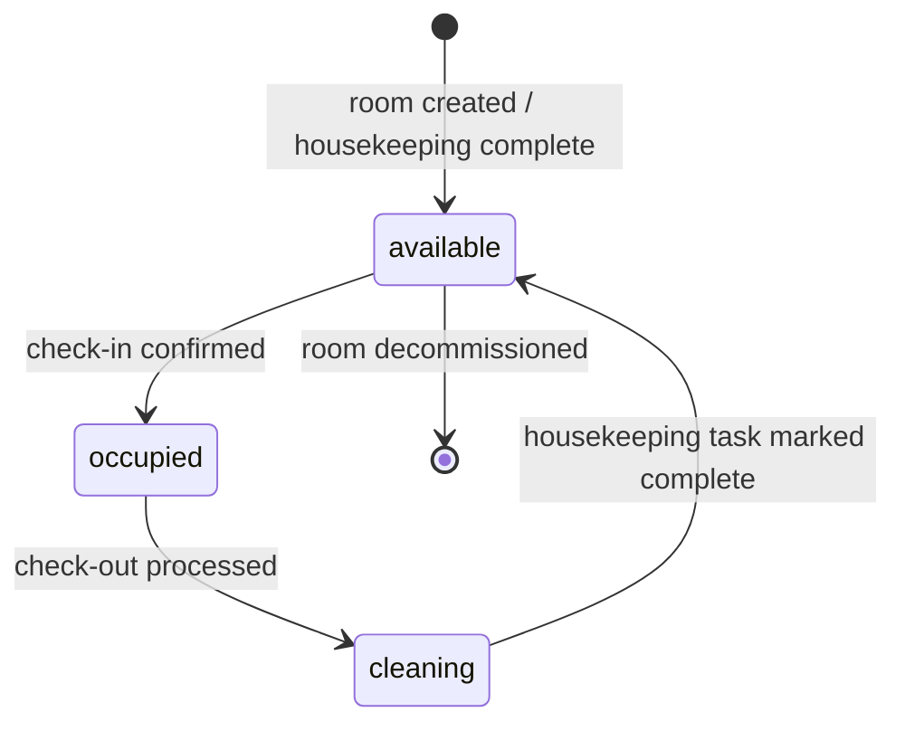
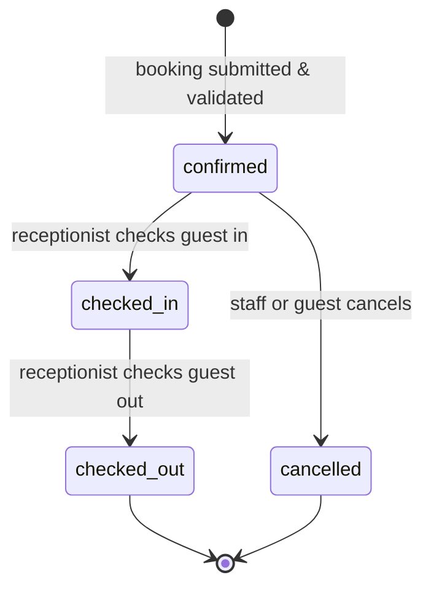
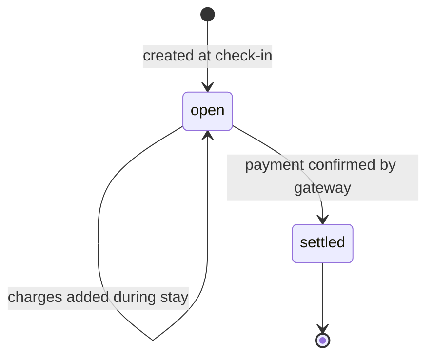

# Design Document — Room Booking Service

## Overview

The Room Booking Service is the authoritative subsystem for room inventory, reservations, guest
check-in/check-out, and housekeeping lifecycle management. It is consumed by three surfaces:

- **frontend-guest** — public booking engine and guest portal
- **frontend-staff** — receptionist, manager, and housekeeping dashboards
- **OTA Channel Manager** — external reservation ingestion and availability sync

---

## Architecture Diagram

```mermaid
graph TB
    subgraph "frontend-guest (port 5173)"
        BE[BookingPage<br/>availability search + direct booking]
        GP[GuestPortal<br/>folio view, QR scan]
    end

    subgraph "frontend-staff (port 5174)"
        RECEP[BookingsPage<br/>check-in, check-out, modify]
        ROOMS[RoomsPage<br/>room status grid]
        HOUSE[HousekeepingQueue<br/>cleaning tasks]
    end

    subgraph "API Layer (Express + TypeScript)"
        RB_API[/api/bookings]
        ROOM_API[/api/rooms]
        FOLIO_API[/api/folios]
        RATE_API[/api/rate-plans]
        QR_API[/api/qr-codes]
    end

    subgraph "Services"
        RBS[RoomBookingService]
        RSS[RoomStatusService]
        FLS[FolioService]
        RPS[RatePlanService]
        OTA[OTAChannelManager]
        NOTIF[NotificationService]
        KYC[KYCService]
        HOUSE_SVC[HousekeepingService]
        QR_SVC[QRCodeService]
    end

    subgraph "Data Layer"
        DB[(PostgreSQL)]
        FS[File Storage<br/>QR codes, invoices, C-Forms]
    end

    BE --> RB_API
    GP --> FOLIO_API
    RECEP --> RB_API
    ROOMS --> ROOM_API
    HOUSE --> ROOM_API

    RB_API --> RBS
    ROOM_API --> RSS
    FOLIO_API --> FLS
    RATE_API --> RPS
    QR_API --> QR_SVC

    RBS --> RSS
    RBS --> FLS
    RBS --> NOTIF
    RBS --> OTA
    RBS --> KYC
    RBS --> HOUSE_SVC
    RBS --> QR_SVC
    RBS --> DB

    RSS --> DB
    FLS --> DB
    RPS --> DB
```

---

## Component Hierarchy

### frontend-guest

```
BookingPage
├── RoomSearchForm          ← date pickers + submit
├── RoomResultsList
│   └── RoomCard            ← photo, type, capacity, price badge
│       └── RateTag         ← shows rate plan price if active
└── BookingConfirmModal     ← guest details form + total preview
```

### frontend-staff — BookingsPage

```
BookingsPage
├── BookingFilters          ← status, date range, room
├── BookingTable
│   └── BookingRow
│       ├── CheckInButton
│       ├── CheckOutButton
│       └── CancelButton
└── BookingDetailDrawer
    ├── GuestInfo
    ├── FolioPreview
    └── ModifyDatesForm
```

### frontend-staff — RoomsPage

```
RoomsPage
├── RoomStatusGrid
│   └── RoomTile            ← color-coded: green/red/yellow by status
└── HousekeepingQueue
    └── TaskCard            ← room number, checkout time, assigned staff
```

---

## State Diagrams

### Room Status Lifecycle



### Booking Status Lifecycle



### Folio Lifecycle



---

## Data Schemas

### Room

```typescript
interface Room {
  id: string                    // UUID v4
  room_number: string           // e.g. "101", "305A"
  room_type: 'Standard' | 'Deluxe' | 'Suite' | 'Presidential'
  capacity: number              // max guests
  price_per_night: number       // base price in INR
  status: 'available' | 'occupied' | 'cleaning'
  floor: number
  photo_url?: string
  description?: string
  amenities: string[]           // e.g. ["AC", "WiFi", "Sea View"]
  created_at: Date
  updated_at: Date
}
```

### RoomBooking

```typescript
interface RoomBooking {
  id: string                    // UUID v4
  guest_name: string
  phone: string
  email?: string
  room_id: string               // FK → Room
  check_in: Date                // midnight local time
  check_out: Date               // noon local time
  source: 'direct' | 'ota'
  ota_platform?: 'booking.com' | 'expedia' | 'airbnb'
  ota_reservation_id?: string
  status: 'confirmed' | 'checked_in' | 'checked_out' | 'cancelled'
  total_price: number           // nights × effectiveNightlyRate
  nights: number                // derived: checkout - checkin in days
  is_foreign_national: boolean  // triggers C-Form generation
  created_at: Date
  updated_at: Date
}
```

### Guest (Customer)

```typescript
interface Customer {
  id: string                    // UUID v4
  phone_number: string          // unique, E.164 format
  name: string
  email?: string
  room_number: string
  current_booking_id?: string   // FK → RoomBooking
  nationality?: string
  passport_number?: string      // for foreign nationals
  loyalty_tier: 'none' | 'bronze' | 'silver' | 'gold' | 'platinum'
  language_preference: string   // BCP-47 locale, default 'en'
  check_in_date: Date
  check_out_date?: Date
  created_at: Date
  updated_at: Date
}
```

### RoomFolio

```typescript
interface RoomFolio {
  id: string                    // UUID v4
  customer_id: string           // FK → Customer
  room_id: string               // FK → Room
  booking_id: string            // FK → RoomBooking
  total: number                 // sum of all FolioCharge.amount
  status: 'open' | 'settled'
  created_at: Date
  settled_at?: Date
}
```

### FolioCharge

```typescript
interface FolioCharge {
  id: string                    // UUID v4
  folio_id: string              // FK → RoomFolio
  type: 'room' | 'food' | 'service' | 'amenity' | 'minibar' | 'misc'
  reference_id?: string         // FK → Order / ServiceRequest / AmenityBooking
  description: string
  amount: number                // positive decimal
  gst_rate?: number             // e.g. 0.12 for 12% GST
  gst_amount?: number           // amount × gst_rate
  timestamp: Date
}
```

### MenuItem (FoodItem)

```typescript
interface MenuItem {
  id: string                    // UUID v4
  name: string
  description: string
  category: string              // e.g. "Breakfast", "Beverages", "Main Course"
  photo_url?: string
  price: number                 // base price in INR
  tax_rate: number              // e.g. 0.05 (5% GST)
  is_available: boolean
  dietary_tags: Array<'veg' | 'non-veg' | 'vegan' | 'gluten-free'>
  current_stock: number
  minimum_threshold: number
  created_at: Date
  updated_at: Date
}
```

### Order

```typescript
interface Order {
  id: string                    // UUID v4
  customer_id: string           // FK → Customer
  room_number: string
  items: OrderItem[]
  status: 'placed' | 'in-kitchen' | 'out-for-delivery' | 'delivered' | 'cancelled'
  subtotal: number              // sum of (quantity × unit_price)
  tax_amount: number            // sum of item-level tax
  service_charge: number        // e.g. 5% of subtotal
  discount: number              // coupon or loyalty discount
  total_amount: number          // subtotal + tax_amount + service_charge - discount
  delivery_time: Date           // requested delivery time
  estimated_delivery?: Date     // staff-set ETA
  notes?: string
  claimed_by?: string           // FK → StaffMember
  claimed_at?: Date
  delivered_at?: Date
  source: 'manual' | 'meal_plan'
  meal_plan_subscription_id?: string
  created_at: Date
  updated_at: Date
}

interface OrderItem {
  id: string
  order_id: string              // FK → Order
  food_item_id: string          // FK → MenuItem
  quantity: number              // ≥ 1
  unit_price: number            // snapshot of price at order time
  tax_rate: number              // snapshot of tax_rate at order time
  subtotal: number              // quantity × unit_price
}
```

### RatePlan

```typescript
interface RatePlan {
  id: string                    // UUID v4
  name: string
  room_type: string
  price_per_night: number
  valid_from: Date
  valid_until: Date
  days_of_week: number[]        // 0=Sun … 6=Sat; empty = all days
  created_by: string            // FK → StaffMember
  created_at: Date
  updated_at: Date
}
```

---

## API Contracts

### POST /api/bookings

**Request:**
```json
{
  "guest_name": "Priya Sharma",
  "phone": "+919876543210",
  "email": "priya@example.com",
  "room_id": "uuid",
  "check_in": "2026-11-01",
  "check_out": "2026-11-05",
  "is_foreign_national": false
}
```

**Response 201:**
```json
{
  "id": "uuid",
  "status": "confirmed",
  "total_price": 14000,
  "nights": 4,
  "confirmation_code": "HTL-2026-00123"
}
```

**Error 409:**
```json
{
  "error": "ROOM_NOT_AVAILABLE",
  "message": "Room 305 is already booked from Nov 3 – Nov 6."
}
```

### GET /api/rooms/availability

**Query params:** `check_in`, `check_out`, `room_type?`, `capacity?`

**Response 200:**
```json
[
  {
    "room_id": "uuid",
    "room_number": "305",
    "room_type": "Deluxe",
    "capacity": 2,
    "effective_price_per_night": 3500,
    "rate_plan_name": "Diwali Special",
    "photo_url": "https://cdn.example.com/rooms/305.jpg"
  }
]
```

### POST /api/bookings/:id/checkin

**Response 200:** Updated `RoomBooking` + new `RoomFolio` + `Customer` record.

### POST /api/bookings/:id/checkout

**Response 200:** Settled `RoomFolio` + final `Invoice` PDF URL.

### GET /api/rate-plans/calendar

**Query params:** `room_type`, `month` (YYYY-MM)

**Response 200:**
```json
[
  { "date": "2026-11-01", "price": 3500, "rate_plan_name": "Diwali Special" },
  { "date": "2026-11-02", "price": 3000, "rate_plan_name": null }
]
```

---

## Key Design Decisions

### Double-Booking Prevention

A PostgreSQL `EXCLUSION CONSTRAINT` using the `tsrange` (timestamp range) type on the
`room_bookings` table prevents overlapping confirmed bookings at the database level — this is the
last line of defense after application-level validation:

```sql
ALTER TABLE room_bookings
  ADD CONSTRAINT no_overlap
  EXCLUDE USING gist (
    room_id WITH =,
    tsrange(check_in, check_out, '[)') WITH &&
  )
  WHERE (status IN ('confirmed', 'checked_in'));
```

### Pricing Consistency

The `total_price` is computed and stored on the `RoomBooking` at creation time by iterating each
night and looking up the most-specific active `RatePlan`. It is not recomputed after booking
confirmation, providing a stable contract for the guest.

### Folio Atomicity

All charge-generating operations (food order placed, service request completed, amenity booked)
call `FolioService.addCharge()` inside the same database transaction as the triggering domain
event. This ensures `RoomFolio.total` is always consistent with its `FolioCharge` records.

### Real-Time Room Status

The `RoomsPage` in `frontend-staff` subscribes to a WebSocket channel `room-status`. The server
broadcasts a minimal payload `{ roomId, status }` whenever a room status changes, allowing the UI
to update individual tiles without a full page reload.
